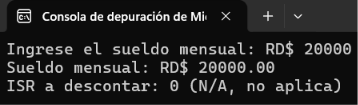
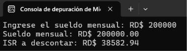

# Cálculo del Impuesto Sobre la Renta (ISR)

**Estudiante:** Ronaldy Santana  
**Matrícula:** 2026-1774  
**Asignatura:** Lógica de Programación  
**Profesor:** Gamalier Reyes del Carmen

## Resumen

Programa en C++ que lee el sueldo mensual de un empleado, calcula el ISR que se le debe descontar según la escala de la DGII para el año 2026 y muestra en pantalla el sueldo y el descuento. Si el sueldo no aplica para ISR, muestra 0 (N/A).

La escala de la DGII es anual, por eso el programa multiplica el sueldo mensual por 12, calcula el ISR anual y lo divide entre 12 para obtener el descuento mensual.

## Cómo funciona

1. El usuario escribe el sueldo mensual.
2. Se calcula el sueldo anual (sueldo mensual x 12).
3. Con if / else if se busca en qué tramo de la escala cae el sueldo anual y se calcula el ISR anual.
4. Se divide entre 12 para sacar el ISR mensual.
5. Se muestra el sueldo y el ISR a descontar. Si no aplica, se muestra 0 (N/A).

## Nota

El programa calcula el ISR directamente sobre el sueldo, sin restar otros descuentos como AFP y SFS.

## Capturas de pantalla

### Sueldo que no aplica para ISR

### Sueldo que aplica para ISR

